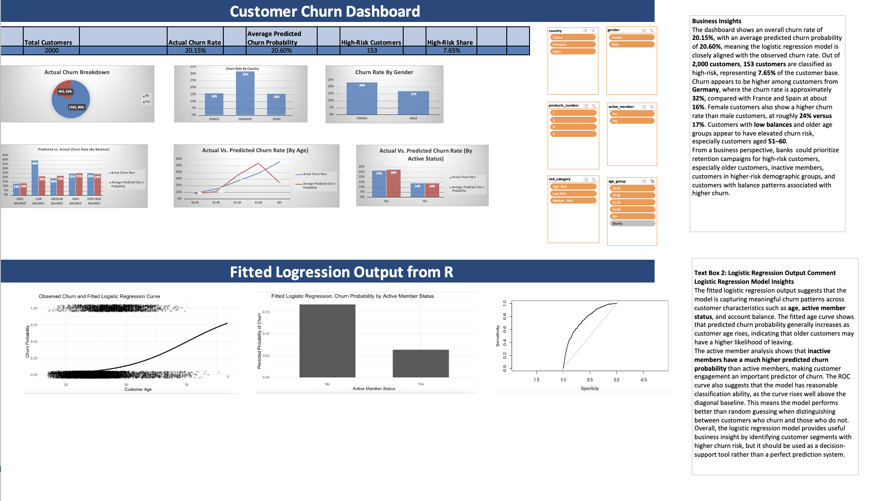

# Bank Customer Churn Prediction

This project uses logistic regression in R to predict whether a bank customer is likely to churn. It also creates a dashboard-ready Excel dataset containing predicted churn probabilities, predicted churn classes, actual churn values, and useful customer segments.

## Project overview

The goal of this project is to answer a practical business question:

> Which bank customers are most likely to churn, and what customer characteristics are associated with higher churn risk?

The analysis uses a logistic regression model because the target variable, customer churn, is binary: the customer either churned or did not churn.

## Repository structure

```text
bank-churn-github-project/
├── README.md
├── requirements.R
├── .gitignore
├── data/
│   └── Bank_Churn_Dashboard_Data.xlsx
├── src/
│   └── ChurnLogRegression.R
├── outputs/
│   └── figures/
└── docs/
    └── GITHUB_UPLOAD_STEPS.md
```

## Files

| File | Purpose |
|---|---|
| `src/ChurnLogRegression.R` | Main R script for preprocessing, model training, evaluation, ROC/AUC analysis, plotting, and exporting dashboard-ready data. |
| `data/Bank_Churn_Dashboard_Data.xlsx` | Excel dataset prepared for dashboard analysis. |
| `requirements.R` | Installs the R packages needed for the project. |
| `docs/GITHUB_UPLOAD_STEPS.md` | Step-by-step instructions for uploading this project to GitHub. |

## Methods used

The R script performs the following steps:

1. Loads the bank customer churn dataset.
2. Converts categorical variables into factors.
3. Removes `customer_id` because it is only an identifier.
4. Splits the data into training and testing sets using an 80/20 split.
5. Fits a logistic regression model using customer characteristics such as age, balance, country, gender, credit score, number of products, credit card status, active member status, and estimated salary.
6. Predicts churn probabilities on the test set.
7. Converts probabilities into churn predictions using a 0.50 cutoff.
8. Evaluates the model using a confusion matrix, accuracy, precision, recall, specificity, ROC curve, and AUC.
9. Creates dashboard-ready fields such as risk category, age group, balance group, credit score group, and salary group.
10. Exports the final dashboard dataset to Excel.

## Key business uses

This project could help a bank:

- Identify customers with higher churn risk.
- Compare churn risk across customer segments.
- Understand how factors like age, balance, active membership, and product count relate to churn.
- Build a dashboard for managers or analysts to monitor churn patterns.

## How to run the project

### 1. Install R and RStudio

Install R from CRAN and RStudio Desktop from Posit.

### 2. Install the required packages

Open RStudio, set your working directory to the project folder, and run:

```r
source("requirements.R")
```

### 3. Add the original raw CSV file

The uploaded R script expects a file named:

```text
bank_customer_churn_Prediction.csv
```

Place that CSV file in the main project folder, or update the file path in `src/ChurnLogRegression.R` to match where your CSV is stored.

### 4. Run the model script

```r
source("src/ChurnLogRegression.R")
```

### 5. Review the results

After running the script, review:

- The model summary in the R console.
- The confusion matrix.
- Accuracy, precision, recall, and specificity.
- The ROC curve and AUC score.
- The exported Excel dashboard dataset.

## Dashboard Preview


